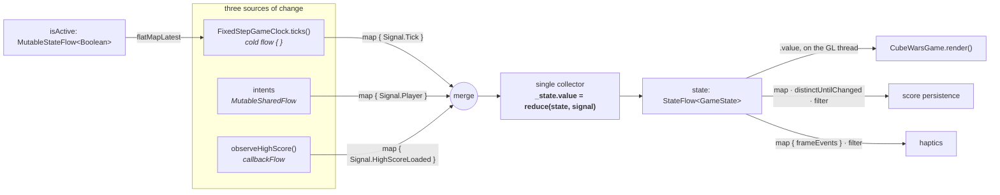

# CubeWars

A 2D Android arena shooter with a **pure-Kotlin simulation core**, where the entire game loop is a
`Flow` pipeline: three independent sources of change are merged into one stream, folded into one
immutable `GameState`, and published as a `StateFlow` that the renderer only ever reads.

No AndroidX. No Compose. No asset files — every sprite is drawn procedurally into a `Pixmap` at
start-up, and the ten arenas are generated into Kotlin source rather than loaded. The runtime
dependency list is two lines long: libGDX, and `kotlinx-coroutines`.

<p>
  
  
  
  
  
  
</p>

---

## Table of contents

- [Why this project exists](#why-this-project-exists)
- [Coroutines and Flow, in detail](#coroutines-and-flow-in-detail)
  - [1. One state, one writer](#1-one-state-one-writer)
  - [2. The clock is a cold Flow](#2-the-clock-is-a-cold-flow)
  - [3. Lifecycle as a Flow switch](#3-lifecycle-as-a-flow-switch-flatmaplatest)
  - [4. Input is a SharedFlow that never blocks](#4-input-is-a-sharedflow-that-never-blocks)
  - [5. Persistence is a callbackFlow](#5-persistence-is-a-callbackflow)
  - [6. Side effects observe the state](#6-side-effects-observe-the-state-they-do-not-live-in-the-fold)
  - [7. Rendering reads, never writes](#7-rendering-reads-never-writes)
  - [8. Testing the pipeline](#8-testing-the-pipeline-with-virtual-time)
  - [Operator inventory](#operator-inventory)
- [Determinism](#determinism)
- [Architecture](#architecture)
- [The game itself](#the-game-itself)
- [Build and run](#build-and-run)
- [Project layout](#project-layout)
- [License](#license)

---

## Why this project exists

A game is the least forgiving place to put a unidirectional data flow. It ticks sixty times a
second, it has a genuinely concurrent input source, it has to survive being backgrounded mid-jump,
and every frame's output must be reproducible or nothing can be tested. CubeWars is that
architecture taken seriously:

- the simulation is a **pure function** `(GameState, dt) -> GameState` — no clock, no I/O, no
  ambient randomness;
- the *only* mutable cell in the entire app is one `MutableStateFlow<GameState>` inside `GameEngine`;
- everything that wants to change the world — the clock, the player's fingers, the high-score
  store — is normalised into a single `Signal` type and folded sequentially by **one** collector,
  which gives a total order over every change with no locks and no compare-and-swap retries;
- the whole domain runs on the JVM with neither Android nor libGDX on the classpath, so a test just
  calls the use case.

---

## Coroutines and Flow, in detail



### 1. One state, one writer

`GameEngine` is the only thing in the codebase permitted to write game state. Three sources want to,
so all three become one flow:

```kotlin
private sealed interface Signal {
    @JvmInline value class Tick(val dt: Float) : Signal
    @JvmInline value class Player(val intent: GameIntent) : Signal
    @JvmInline value class HighScoreLoaded(val value: Int) : Signal
}

loop = scope.launch {
    merge(
        ticks,
        intents.map { Signal.Player(it) },
        scoreRepository.observeHighScore().map { Signal.HighScoreLoaded(it) },
    ).collect { signal -> _state.value = reduce(_state.value, signal) }
}

private fun reduce(current: GameState, signal: Signal): GameState = when (signal) {
    is Signal.Tick            -> advanceGame(current, signal.dt)
    is Signal.Player          -> applyIntent(current, signal.intent)
    is Signal.HighScoreLoaded -> current.copy(highScore = maxOf(current.highScore, signal.value))
}
```

Because a single coroutine performs every write, there is a **total order** over every change to the
world. An intent can never land halfway through a simulation step, two ticks can never interleave,
and no `synchronized` block or atomic `update {}` retry loop appears anywhere in the project.
`reduce` is a pure `when` — the entire mutation surface of the game is those three lines.

> The `Signal` variants are `@JvmInline value class`es, so normalising three sources into one type
> costs no allocation per tick.

### 2. The clock is a cold Flow

`GameClock` is a `fun interface` returning `Flow<Float>` — a cold flow of step durations, where
*collecting it starts a new timeline*. That single design choice is what makes pausing correct
(see below) and what lets tests replace wall time with a `MutableSharedFlow` they emit into by hand.

```kotlin
fun interface GameClock {
    /** A cold flow of step durations in seconds. Collecting it starts a new timeline. */
    fun ticks(): Flow<Float>
}

override fun ticks(): Flow<Float> = flow {
    var previous = nanoTime()
    var accumulator = 0.0

    while (currentCoroutineContext().isActive) {
        accumulator += (nanoTime() - previous) / NANOS_PER_SECOND
        // ...
        var emitted = 0
        while (accumulator >= stepSeconds && emitted < maxCatchUpSteps) {
            emit(step)                      // always exactly 1/60s — never the measured frame time
            accumulator -= stepSeconds
            emitted++
        }
        if (accumulator > stepSeconds * maxCatchUpSteps) accumulator = 0.0   // declare bankruptcy
        delay(untilNextStep.coerceIn(1L, 16L))
    }
}
```

Every emission is exactly `1/60s` regardless of how the device is behaving, so physics cannot vary
between a 60 Hz and a 120 Hz screen. A slow frame is absorbed by the accumulator, which emits
several steps back to back to catch up — but never more than five, past which it drops the debt
rather than entering a death spiral where catching up costs more time than it recovers.

Cooperative cancellation comes free: the `while (currentCoroutineContext().isActive)` loop and the
`delay` suspension point mean cancelling the collector stops the clock at the next step, with no
flag to check and no thread to interrupt.

### 3. Lifecycle as a Flow switch (`flatMapLatest`)

Backgrounding the app must not merely *ignore* ticks — it must tear the clock down, because a clock
that kept accumulating through a five-minute pause would try to simulate five minutes of catch-up on
resume:

```kotlin
private val isActive = MutableStateFlow(false)

val ticks = isActive
    .flatMapLatest { active -> if (active) clock.ticks() else emptyFlow() }
    .map { Signal.Tick(it) }
```

`flatMapLatest` cancels the previous inner flow whenever `isActive` changes, so `pause()` is a
boolean write that *destroys* the timeline and `resume()` is a boolean write that builds a fresh
one. The Android lifecycle reduces to two assignments:

```kotlin
fun pause() {
    isActive.value = false
    dispatch(GameIntent.ReleaseAll)            // losing focus mid-jump must not stick the button down
    if (_state.value.status == GameStatus.RUNNING) dispatch(GameIntent.TogglePause)
}

fun resume() { isActive.value = true }
```

### 4. Input is a SharedFlow that never blocks

Touches arrive on the GL thread. The simulation runs on `Dispatchers.Default`. The renderer must
never be blocked by the simulation, so intents go through a buffered `MutableSharedFlow` and a
non-suspending `tryEmit`:

```kotlin
private val intents = MutableSharedFlow<GameIntent>(
    replay = 0,
    extraBufferCapacity = 64,
    onBufferOverflow = BufferOverflow.DROP_OLDEST,
)

/** Queues a player intent. Safe to call from any thread, including the render thread. */
fun dispatch(intent: GameIntent) {
    intents.tryEmit(intent)
}
```

`DROP_OLDEST` is the right policy for a game: if the simulation ever fell 64 intents behind, the
freshest ones are the ones worth keeping. The input layer is handed nothing but `engine::dispatch`
(`GameInputProcessor(hudRenderer.viewport, engine::dispatch)`), so it *cannot* reach the state —
`GameIntent` is the only channel it has, and nothing in the domain knows a touchscreen exists.

### 5. Persistence is a `callbackFlow`

The high score lives in `SharedPreferences`, whose listener API is bridged into the pipeline so a
score written from anywhere reaches the engine without anyone having to remember to push it:

```kotlin
override fun observeHighScore(): Flow<Int> = callbackFlow {
    send(preferences.getInt(KEY_HIGH_SCORE, 0))

    val listener = SharedPreferences.OnSharedPreferenceChangeListener { store, key ->
        if (key == KEY_HIGH_SCORE) trySend(store.getInt(KEY_HIGH_SCORE, 0))
    }
    preferences.registerOnSharedPreferenceChangeListener(listener)
    awaitClose { preferences.unregisterOnSharedPreferenceChangeListener(listener) }
}.distinctUntilChanged().conflate().flowOn(io)
```

`awaitClose` guarantees the listener is unregistered on cancellation; `conflate()` means a burst of
writes costs the engine one fold, not five; `flowOn(io)` moves the preference read off the
simulation dispatcher without the *collector* knowing anything changed. The domain sees only
`fun observeHighScore(): Flow<Int>` — the interface lives in `domain/repository`, the Android
implementation in `data/score`, and the dependency arrow points inward.

### 6. Side effects observe the state, they do not live in the fold

The fold must stay pure, so anything with a real-world consequence subscribes to the published state
instead. Both side effects in the game are written this way — score persistence, in the engine:

```kotlin
scope.launch {
    state.map { it.status }
        .distinctUntilChanged()
        .filter { it == GameStatus.GAME_OVER }
        .collect { scoreRepository.submitScore(_state.value.score) }
}
```

…and haptics, in `GameActivity`:

```kotlin
scope.launch {
    container.engine.state
        .map { it.frameEvents }
        .filter { it.isNotEmpty() }
        .collect(container.haptics::play)
}
```

`distinctUntilChanged()` on a derived key is what makes "exactly once per game over" true by
construction rather than by a `hasSubmitted` boolean. And because haptics are driven by *observing
state* rather than by the renderer, a slow frame can never fire the same buzz twice — `frameEvents`
holds only the events produced by the step that built that state, so events are part of the state
rather than a side channel.

### 7. Rendering reads, never writes

`CubeWarsGame.render()` never advances anything. It reads the latest published value and draws it:

```kotlin
override fun render() {
    val state = engine.state.value        // a conflated snapshot; never blocks the GL thread
    inputProcessor.gameplayEnabled = state.status == GameStatus.RUNNING
    worldRenderer.render(state)
    hudRenderer.render(state, inputProcessor.pressedButtons())
}
```

Simulation and rendering are therefore fully decoupled: **a dropped frame costs a frame of
animation, not a frame of physics.** Renderers hold no gameplay state at all — everything that looks
like animation (squash, hit flash, spawn fade, screen shake) is a field on `GameState`, which makes
the renderer a pure projection of one value.

The scope those coroutines live in is created once, in the one Android class the project has:

```kotlin
private val scope = CoroutineScope(SupervisorJob() + Dispatchers.Default)
// ...
override fun onDestroy() { scope.cancel(); super.onDestroy() }
```

`SupervisorJob` so a failure in the haptics collector cannot take the simulation down with it;
`Dispatchers.Default` so the fold runs off the main thread; one `cancel()` to tear down the clock,
the collectors and the preference listener together.

### 8. Testing the pipeline with virtual time

`GameEngineTest` runs the real engine with a hand-driven clock and zero wall time:

```kotlin
private val ticks = MutableSharedFlow<Float>(extraBufferCapacity = 256)
private val clock = GameClock { ticks }          // fun interface: the whole fake is one lambda

private fun TestScope.tick(times: Int) {
    repeat(times) { check(ticks.tryEmit(STEP)) }
    runCurrent()
}

@Test
fun `starting twice does not start two loops`() = runTest {
    val engine = engineIn(backgroundScope)
    engine.start()
    engine.start()
    runCurrent()
    engine.dispatch(GameIntent.Start)
    runCurrent()

    tick(60)

    assertEquals("a doubled loop would simulate each tick twice", 1f, engine.state.value.elapsedTime, 0.01f)
}
```

Two details worth stealing:

- the engine is given **`backgroundScope`**, so `runTest` does not hang waiting for a collector that
  by design never completes;
- ticks are pumped with **`runCurrent()`, not `advanceUntilIdle()`** — `advanceUntilIdle` returns as
  soon as only background work is left, so it would never run the engine's collectors at all.

That suite pins down the behaviours the Flow design is supposed to buy: ticks are ignored on the
title card, intents and ticks fold into one ordered stream, a stored high score is folded in on
subscription, `pause()` disconnects the clock while still accepting intents, `resume()` reconnects
it with a fresh timeline, and `start()` is idempotent.

### Operator inventory

Every coroutines API used in the project, and the reason it is there:

| API | Where | Why that one |
| --- | --- | --- |
| `MutableStateFlow` / `asStateFlow()` | `GameEngine._state` | one mutable cell, read-only to the world |
| `merge` | `GameEngine.start()` | three sources → one totally ordered stream |
| `flatMapLatest` | tick gating | pausing must *cancel* the timeline, not filter it |
| `emptyFlow()` | tick gating | the "paused" branch of the switch |
| `flow { }` | `FixedStepGameClock` | cold: each collection is a new timeline |
| `MutableSharedFlow` + `tryEmit` | player intents | never block the GL thread |
| `BufferOverflow.DROP_OLDEST` | player intents | under backlog, freshest input wins |
| `callbackFlow` + `awaitClose` | `PreferencesScoreRepository` | listener API → flow, unregistered on cancel |
| `conflate()` | high score | a burst of writes is worth one fold |
| `flowOn(io)` / `withContext(io)` | high score | move I/O without the collector knowing |
| `map` · `distinctUntilChanged` · `filter` | both side effects | "exactly once per transition", by construction |
| `currentCoroutineContext().isActive` + `delay` | clock loop | cooperative cancellation, no flags |
| `SupervisorJob` + `Dispatchers.Default` | `GameActivity` | isolate failures; keep the fold off the main thread |
| `runTest` · `TestScope` · `backgroundScope` · `runCurrent` | `GameEngineTest` | virtual time; never wait on an endless collector |

---

## Determinism

Randomness and entity ids live **inside** the state. `Rng` is a value class advanced functionally,
and a use case that needs either opens a `SimulationCursor` via `state.cursor()`, mutates it
locally, and `commit(state)`s once — the mutation never escapes the stack frame, so the function
stays pure.

The payoff is a test that would be impossible in a conventional game loop:

```kotlin
@Test
fun `the same seed and the same inputs produce byte-identical states`() {
    val input = InputState(moveAxis = 1f, fireHeld = true, jumpHeld = true)

    val first  = playFor(seconds = 12f, seed = 20_260_814L, input = input)
    val second = playFor(seconds = 12f, seed = 20_260_814L, input = input)

    assertEquals(first, second)     // twelve seconds of combat, compared with ==
}
```

`SimulationContractTest` also pins that the title card and pause screen freeze the world *completely*
(`assertEquals(paused.copy(frameEvents = emptyList()), later)` after 120 steps), and that after a
loss the debris keeps settling while the score can no longer change. If those break, the
architecture has stopped paying for itself.

---

## Architecture

Three layers, and the dependency arrow only ever points inward: `presentation` → `domain` ← `data`.
`di/AppContainer.kt` is the composition root and the only place a concrete implementation is named —
which is precisely what lets the whole domain be exercised in plain JVM tests.

**The simulation is an ordered fold of stages.** `AdvanceGameUseCase` folds a list of
`SimulationStage` (`fun interface`, same `(GameState, dt) -> GameState` signature), and *the order is
the specification*:

```
wave director → player → enemies → projectiles → combat → particles → camera → level advance
```

Combat resolving after all movement means a bullet and a cube that swap places in the same step
still trade damage; the level swap runs last so every other rule has finished with the old world
before it is replaced. Adding a rule means adding a stage, not editing the orchestrator.
`GAME_OVER` runs a shorter `epilogueStages` list so debris and the camera keep moving but the
outcome cannot change.

---

## The game itself

**Enemies are data, not branches.** An `EnemyArchetype` is a row of numbers plus three things the
rules read by name: a `MovementStyle` (patrol, rooted, hop, hover, charge — five branches covering
eight archetypes), a set of `EnemyPower`s asked for by name (`archetype.has(MARKSMAN)`) rather than
switched on by type, and exactly one `EnemyWeakness`. Adding an enemy is usually a row and a colour.

**Weaknesses are the puzzle.** Each of the eight archetypes has one thing it cannot take — a
headshot, an underbelly, a backstab, plunging fire, point blank, a long shot, an airborne shot — and
finding it triples the damage. `domain/combat/WeakSpots.kt` decides whether a shot found one, and
`WorldRenderer` paints the same band — measured off the same `GameConfig.WEAK_SPOT_BAND` figure the
rule uses — on the cube *before* the player has to guess. The marker is not a hint about the weak
spot; it **is** the weak spot. The conditional weaknesses, which cannot be painted on a body, hang
above the cube as a coloured pip whose colour is the only thing the player has to learn.

**Bullets fall.** Every `Projectile` carries its own `gravityScale` — the whole difference between a
sniper's flat round, the player's gentle drop, and a mortar shell lobbed over cover — which means
"point at the target" is no longer the same thing as hitting it. `domain/physics/Ballistics.kt`
solves the launch angle that actually arrives, leads a moving target, and samples the trajectory;
enemies aim with it and the renderer draws the player's arc with it, so the promise on screen and
the shot in flight cannot drift apart.

**Levels are generated, not authored.** `tools/generate_levels.py` designs the ten-arena rotation and
writes it into `data/level/GeneratedLevels.kt` as Kotlin source — no asset, no parser, no I/O near
the domain. A layout is only playable if it agrees with the physics (a block one tile taller than a
jump is a wall across the only route to the gate; a pit one tile wider than a running jump is a dead
end), and that is arithmetic, not taste — so the generator validates every arena against the real
`GameConfig` numbers before writing it out, and `ArenaGeometryTest` re-measures the same invariants
by running the actual simulation.

**Everything is drawn at runtime.** Ten `LevelTheme`s, one `ArenaSkin` each in
`presentation/render/Palette.kt`, baked into textures by `TextureFactory` at start-up on a 480×270
virtual screen sampled `Nearest`. Zero image files in the repository.

---

## Build and run

Requires JDK 21 (Gradle provisions its own daemon JVM via `gradle/gradle-daemon-jvm.properties`
regardless of what is on `PATH`) and an Android SDK with API 36.

```bash
./gradlew :app:testDebugUnitTest                                     # all 108 JVM unit tests
./gradlew :app:testDebugUnitTest --tests '*SimulationContractTest*'  # one class
./gradlew :app:compileDebugKotlin                                    # fast type-check
./gradlew :app:assembleDebug                                         # APK
./gradlew :app:installDebug                                          # deploy to a device
./gradlew :app:unpackGdxNatives                                      # explode libGDX .so jars

./tools/generate_levels.py                                           # regenerate the arena rotation
./tools/generate_levels.py --sketch --dry-run                        # draw the layouts, write nothing
```

Tests are plain JUnit 4 on the JVM — no Robolectric, no instrumented tests, no mocking framework.
The only test dependency beyond JUnit is `kotlinx-coroutines-test`.

Two build details worth knowing before touching Gradle:

- Kotlin is compiled by **AGP 9's built-in Kotlin support**; there is deliberately *no* Kotlin Gradle
  plugin in `libs.versions.toml`.
- libGDX ships `libgdx.so` at the root of plain jars, which AGP cannot package, so a custom
  `UnpackGdxNativesTask` plus a `gdxNatives` configuration reshapes them into a `jniLibs` layout,
  wired in through `androidComponents.onVariants`.

---

## Project layout

```
app/src/main/java/com/heixss/cubewars/
├── di/AppContainer.kt              # composition root — the only place an implementation is named
├── domain/                         # no Android, no libGDX, no I/O
│   ├── engine/GameEngine.kt        #   ← the Flow pipeline: merge → fold → StateFlow
│   ├── engine/GameClock.kt         #   ← the cold fixed-step tick flow
│   ├── model/GameState.kt          #   the entire world, as one immutable value
│   ├── usecase/                    #   the simulation stages, in specified order
│   ├── physics/Ballistics.kt       #   launch angles, target leading, trajectory sampling
│   ├── combat/WeakSpots.kt         #   one answer, two callers (combat + renderer)
│   └── config/GameConfig.kt        #   every gameplay constant, out of the rules
├── data/
│   ├── level/GeneratedLevels.kt    # generated — regenerate, never hand-edit
│   └── score/PreferencesScoreRepository.kt   # callbackFlow over SharedPreferences
└── presentation/
    ├── GameActivity.kt             # the single Android entry point; owns the CoroutineScope
    ├── CubeWarsGame.kt             # libGDX ApplicationListener — reads state, never writes
    ├── input/                      # touches and keys → GameIntent
    └── render/                     # procedural textures, world + HUD viewports

app/src/test/java/com/heixss/cubewars/domain/   # 108 plain JVM tests
tools/generate_levels.py                        # designs and validates the arena rotation
```

Roughly 6,100 lines of Kotlin in `main`, 2,300 in `test`.

---

## License

Released under the [MIT License](LICENSE) — do what you like with it, keep the notice.

libGDX, the only third-party runtime dependency, is [Apache 2.0](https://github.com/libgdx/libgdx/blob/master/LICENSE).
